# Background

## Mercor

Mercor is a company whose business consists of, for the most part, two portions: an AI interviewer and B2B data labeling. Broadly speaking, their AI interviewer can be broken down into three primary parts:
- Starting page: interviewee enters their GitHub profile, for which our app then scrapes the info of to gain context for the AI interviewer 
- Interview: the actual interview, hosted with a realtime AI voice model
- Results page: the results of the interview (for our app, this may currently take up to 2-3 minutes) and a transcript of the conversation are displyed

From a context/business perspective, we can also break down the full functionality through the lens of stakeholders:

- Talent
  - Select form a list of jobs
  - Upload their resume and join interview
  - Complete interview with AI
    - This should automatically recorded and graded
- Recruiters/Companies
  - Click into each job listing
  - View candidates' recorded interviews
 
## Merclone

Merclone focuses on just the three primary parts of Mercor's AI interviewer as defined at the very top (at least for the time being):

1. **Pre-interview** starting page: User enters their GitHub profile, then clicks 'start interview'.
  - 
2. **Live interview:** User is prompted for mic access, and once this is received, they begin discussion with AI interviewer. The interviewer typically lets the conversation wrap up in less than ~5 minutes (as of the current V1.1), and will prompt the user to click 'End Interview' once it has completed questioning, although the user may choose to end at any time (ofc in this case at the risk of poorer interview results).
  - 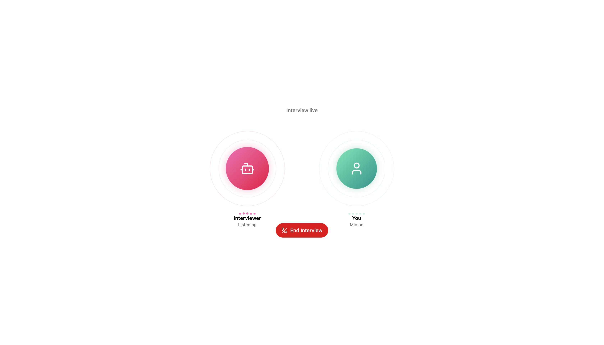
3. **Post-interview** results page: After the interview transcript is analyzed, the results are graded (this takes up to 5 minutes; on rare occasions this may fail due to Merclone currently being on Gemini API's free tier, although based on testing this has been very uncommon). While the grading happens, users can save the URL of their results page, close out/navigate away from it, and then return at any time. Once grading is complete, the page automatically refreshes with a score out of 10 for the interviewee, feedback, and a full transcript of the conversation. 
Here's a pretty much (very much) blurred out example of a test run, just to show the structure of the final results page, as well as what the grading output can potentially read like:
  - 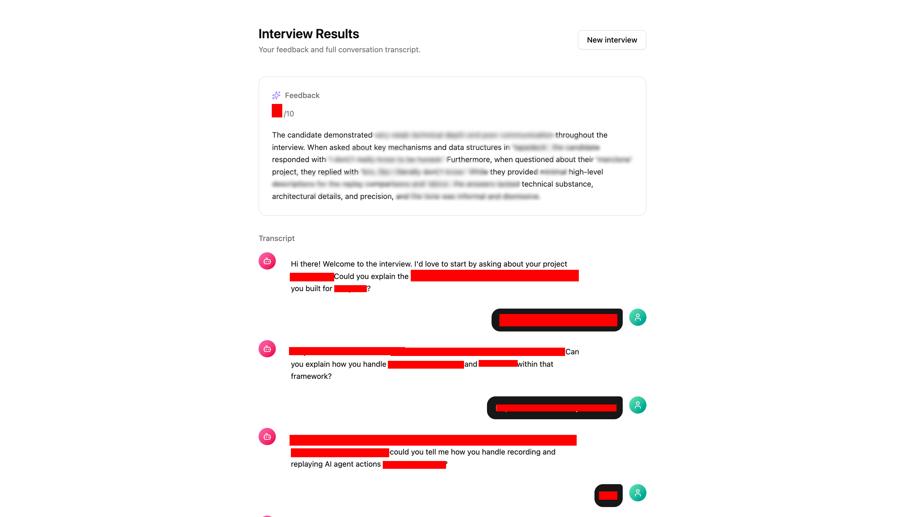

However, the implementation of these features was not as trivial as it may seem from the surface. The primary challenges for implementation are as follows:

1. Parsing the users experience, i.e. processing their resume, scraping the links from their resume
2. Post-start interview process. The first four below (a-d) are hard components for building a voice agent, minus the video
   a. Text to Speech, TTS. The step that is least expensive to run out of steps a-c.
   b. WebRTC for real-time web browser communication
   c. Speech to Text, STT. Typically cheaper than TTS.
   d. Small language Model, SLM for reasoning about user responses. A larger model would have more latency which would not be ideal.
   e. For adding video for interviewer, you'd need to add real-time video generation model. Less of these--or at least, quality open-source ones--currently exist compared to TTS and STT models, and otherwise non-self hosted models are typically very expensive (i.e. 5x more than for steps a-d).

The architecture analysis below primarily references and builds on this tutorial: https://www.youtube.com/watch?v=iNJ7z4YLQFk&t=1066s. The documentation below comes from a combination of what was covered in the video and my own explanations & considerations. For development (see the sections below), our Part 1: Scrape is built based on the tutorial. However, in Parts 2-3, we use the Gemini instead of OpenAI API due to costs, making our implementation differ significantly. Specifically, for these parts, Claude Code was used to discuss architecture tweaks due to our usage of a different AI model/provider, with the implementation and final decisions made on my own.

# Architecture

We start off by considering our approach for data scraping, then the general architecture of voice agents, and finally move on to the more niche architecture of our AI interviewer app.

## Data Scraping

Before the user can enter their interview, we want to allow them to enter their LinkedIn (in a future version) and GitHub links and scrape data from these sources without going through a third-party service.

For **GitHub**, this is relatively straightforward and we can do it directly via their API. On the other hand, **LinkedIn**, due to its complexity, will be added on later. For context/as a touch on a potential solution path though, since LinkedIn has no API, we can only open the webpage via a browser and scrape as much as we can from it. Doing this in-house can quickly result in rate limits, which is why we would use a proxy server to scrape LinkedIn instead. This way, it will not see the same IP address every time we hit and thus do not get rate-restricted.

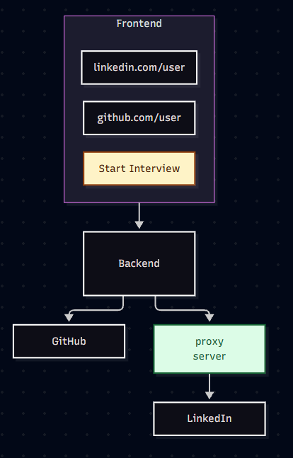

## Voice Agent Architectures

There are three primary approaches for building a voice agent.

### Approach 1: Cascaded pipeline

Advantages:

- cheaper
- more flexible

Tradeoffs:

- slower

Consists of three models: SST, LLM, TTS.

Here, Vaal is a service which strips the raw audio of external noise (i.e. dogs barking, toilet flushing in the background).

Other tools that may be used throughout this process:

- LiveKit SDK, a popular library for voice agents which don't necessarily host the LLMs themselves, but let you select/switch fluidly between them. If you don't use this library, you'd just need to build the inference layer yourself.

### Approach 2: Voice model

Advantages:

- faster
- maintainability/dev experience

Tradeoffs:

- more expensive
- dependency lock-in

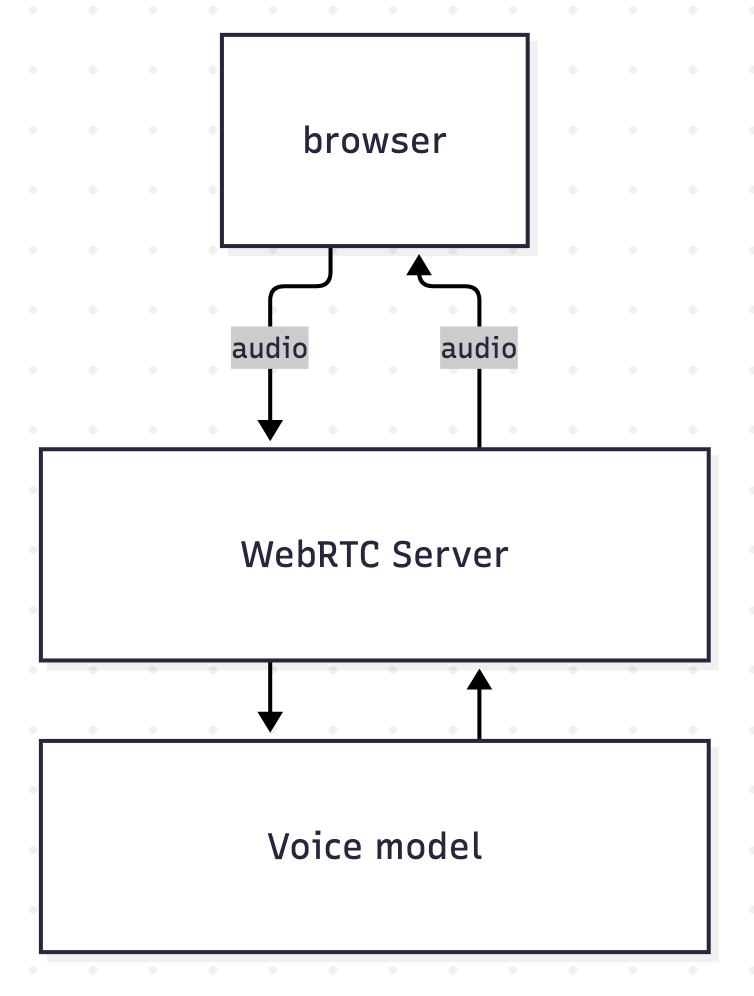

Consists of a single model which is trained (both inputs and outputs) based on audio, such as OpenAI or Gemini's low-latency voice models.

Oftimes, these voice models will be multimodal as well--that is, be able to accept text, images, perhaps even multiple calls. It is also easier to maintain the code following this approach since we wouldn't need to maintain 3 pipelines.

The tradeoffs here are firstly, that it is around $30-40\%$ more expensive, although clearly not significantly so. Secondly, building based on a specific voice model means it will take at least some engineering effort to switch to a different model later down the line.

## AI Interviewer Architectures

### Approach 1: Direct server connection

Advantages:

- Fast

Tradeoffs:

- System prompt directly via client
- No record of convo, since our server never part of it

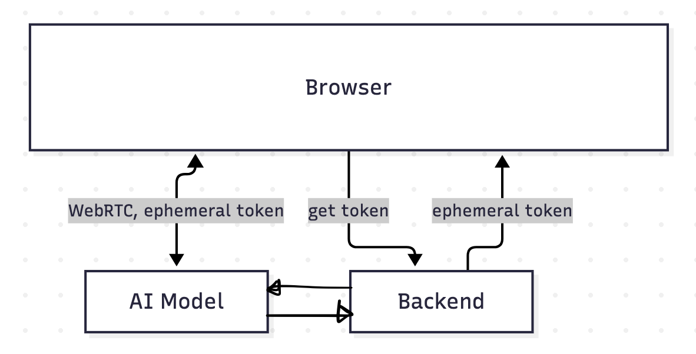

In this approach, we connect the browser directly to our AI server/model, making for a low-latency user experience.

The main tradeoffs are twofold: To begin with, it risks users manipulating the system prompt (since it is passed directly from the client to the server). It also means we can't have any record of the AI conversations, since our server is never a part of this communication exchange between the client and model.

### Approach 2: Approach 1, but record the convos

Advantages:

- Fast

Tradeoffs

- Clients can still manipulate server prompt

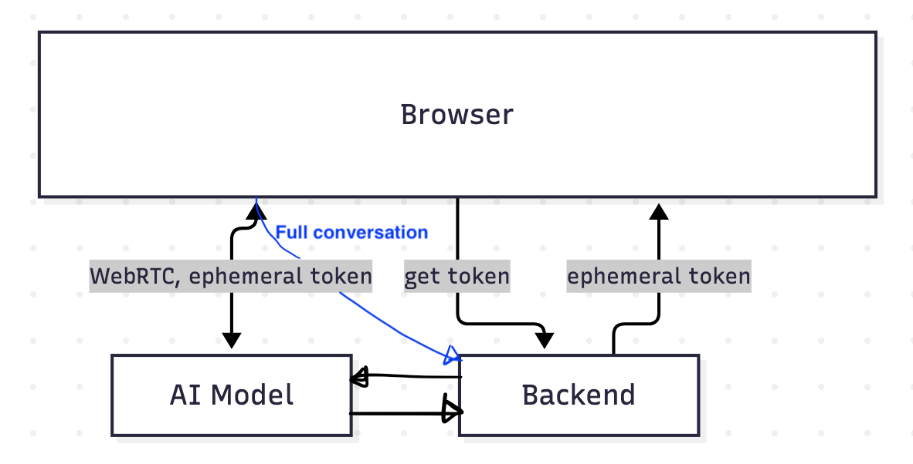

The only difference between this and the prior approach is that we record the conversations with the backend.

### Approach 3: Websocket connection (OpenAI)

Advantages:

- backend gets live stream of convo
- system prompt sent by backend

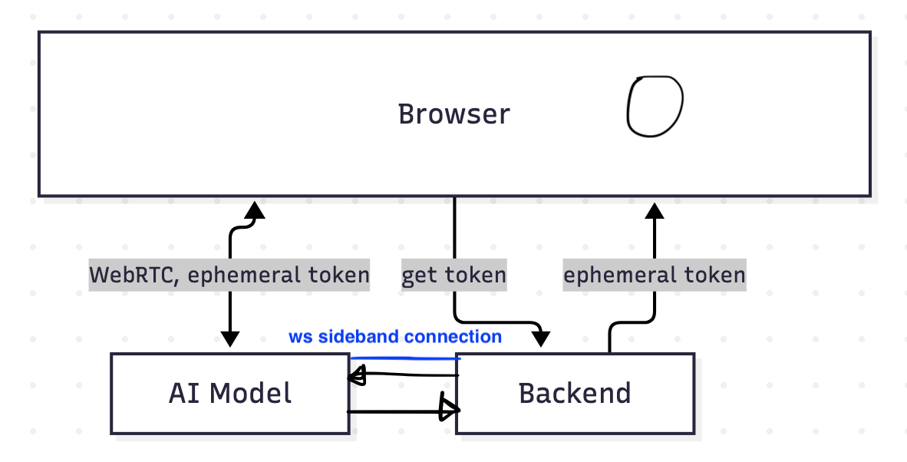

The same architecture as approach 1, except we add a websocket connection between the browser and the AI server.

There are several key security guardrails here: to begin with, the client cannot manipulate the server prompt, because it is the backend which sends it. Also, the AI-client communication records are passed directly/in real-time between the AI server and backend (instead of passed through the browser, where the risk is that the browser/client could manipulate the data). Finally, the backend would now have greater context as to why, for instance, certain functions are called.

Therefore, while adding a websocket connection does not prevent the user from attempting to manipulate via their inputs, it does give the browser fuller, more accurate, and more up-to-date context on what is going on between their conversation.

While the video tutorial implements this approach, it is dependent on using the OpenAI API and the fact that it supports a sideband; Gemini does not.

### Approach 4: Backend Centered (Gemini)

Advantages:

- backend gets livestream of convo
- system prompt sent by backend

Disadvantages:

- greater latency
- less stable browser <-> AI model connection

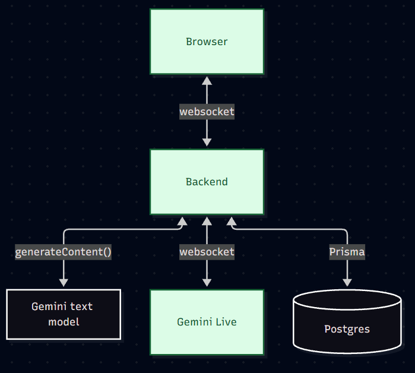

The next most obvious approach is to have all communication centered at the backend. Ofcourse here, we trade off latency for security.

Gemini also doesn't use WebRTC, so if we wanted to we'd need a translator/media server in between. Although WebRTC handles bad internet well, we'll simply send raw audio via a Websocket instead. This does risk the Websocket freezing/stuterring issues if internet connection is unstable. If this ends up causing issues down the line, tools like LiveKit or Pipecat can be added later.

Approach 4 is the method we used for Merclone.

# Development - V1.0

We built the first version of our app using the following languages, libraries and frameworks:

- **React** JS library for frontend
- **Axios**, an HTTP client library for JS/TS environments
- **ShadCN** for styling
- **TailwindCSS** for stylingr
- **Express.js** framework for backend
- **Zod**, a TS validation library
- **Prisma** for talking with our db
- **PostgreSQL** for our database
- **Gemini AI Studio** for its voice and text APIs
- **React Router** for routing
- **Neon** for deployment Postgres
- **Render** for deployment websocket

Our primary file structure reads cleanly as:

- `apps/backend` for all our backend code
- `apps/frontend` for all our frontend code

To initialize our project, we use the command-line package executor `bunx` (over `npx`, because the former has substantially faster startup times).

## Part 1: Scrape

We started by building the homepage before the users go into the interview, as well as the scraping functionality for the data the user enters into the pre-interview page form.

### Frontend

We set up React as our frontend and Express.js as our backend library with `bunx`. Next, in `App.jsx`, we put up a simple interview kickstart page which prompts the user for their GitHub (and in the future, possibly LinkedIn/other account) links. If the user inputs are invalid--which we check via the `Zod` validation library--then we give them a toast message (ShadCN `sonner` component):
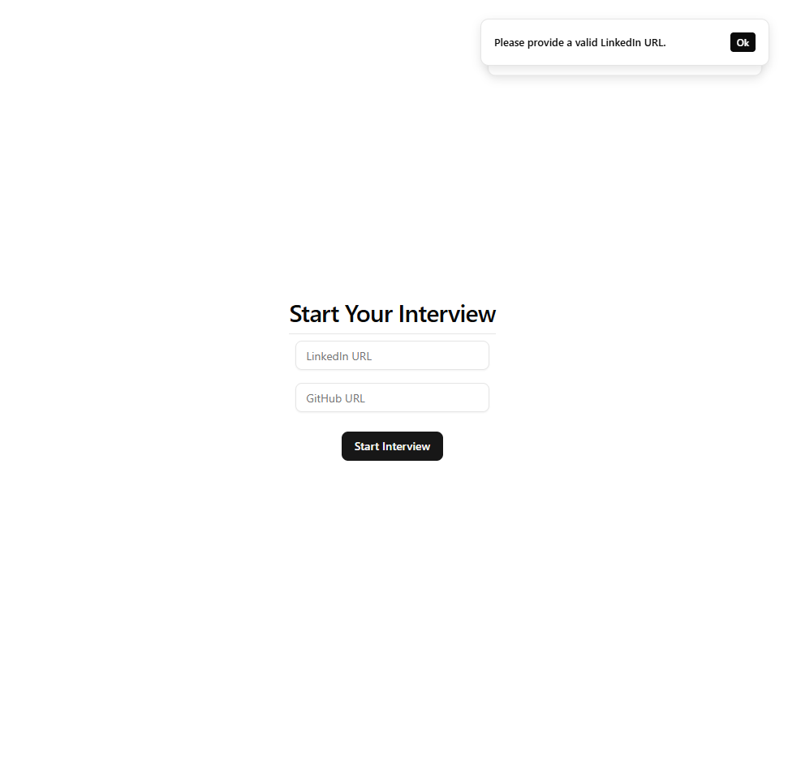

### Backend

The frontend to backend workflow runs as folows:

- Once the user fills out the interview form, `Form.tsx` makes an HTTP POST request using the axios library to `localhost:3001/api/v1/pre-interview` with the collected `{ github }` values as JSON in the body
- In `backend/index.ts`, an express listener detects this (`app.post("/api/v1/pre-interview", async ...`), turning the raw body into `req.body`, preforming validation checks and fetching GitHub
- Express sends the result back to frontend, where in `Form.tsx`, the function `await axios.post(...)` awaits the data.

## Part 2: Interviewer

Next, we built out the actual AI interviewer.

To clean things up, we first kicked things off by adding routing to our app and adding our interviews to a db. For the latter, we set PostgreSQL as our database and in `schema.prisma`, defined the models `Interview` and `Message` which store info on an interview and specific messages (of, for instance, conversations between a user and an AI model) respectively. Then we spun up our Prisma Client, and for local development temporarily used a locally containerized PostgreSQL server hosted via Docker.

### System Prompts

We started by building our system prompts within `apps/backend/prompts.ts`. These are the first things passed to Gemini to give it context on its role and the interviewee. Here, we briefly used AI to formalize our prompt texts. This was to ensure the prompts were optimized for an AI model's understanding.

### Live Interview

There are a few key parts which work together to make the live interviews possible:

- **Gemini bridge**- instead of a sideband, we use one Gemini bridge (an open source dev tool) per interview to connect our AI session to the browser's socket and our backend to the Gemini session
  - Another contributing part of this code lives in `liveSession.ts`, where `start()` is triggered first when the browser gets access to user audio mic, and finishing by calling `finishInterview` in `results.ts`. Overall, `liveSession.ts` handles:
    - Connecting to, maintaining and closing the Websocket connection
    - Recording messages via Prisma
    - Updating our db on the status of the interview
- **Express** framework - handles the talking between the backend, to the database and to the browser. Configured in `index.ts`.
  - Listens for websocket upgrades
  - Listens for HTTP requests for and pre-interview and results postings
  - Calls `InterviewBridge` from `liveSession.ts` which then spins up a Gemini session and starts interview
- Audio handling - since we have a Websocket instead of WebRTC, we must implement handling raw PCM audio. This code is in `audio.ts` under `frontend/`, because clearly only our browser, and not the backend server, has mic and speakers.
  - 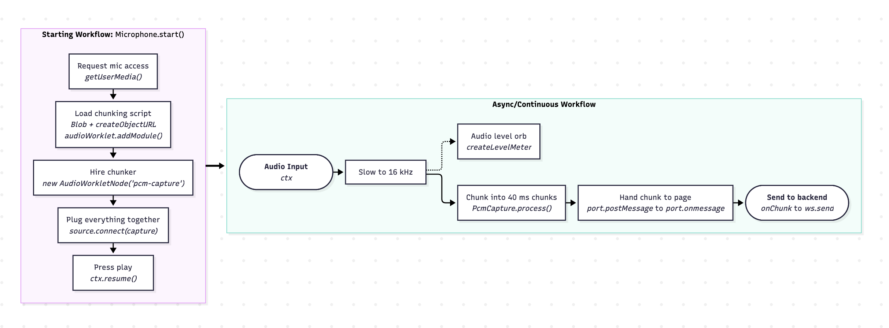
  - 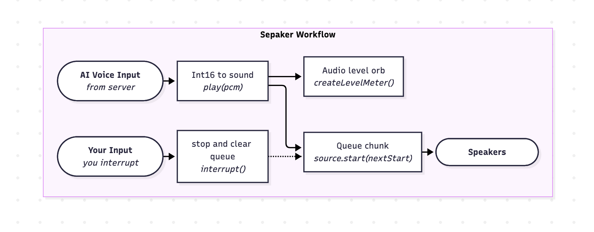

### Frontend
The interview frontend lives in `Interview.tsx`. It also uses a new `VoiceOrb.tsx` component for visualizing the speakers' audio levels. 

## Part 3: Grader/Results

### Backend
All grading logic lives in `apps/backend/results.ts`.

After the interview, we call Gemini again--not a live voice, but a text model--to generate feedback and process the interview results. The function `finishInterview()` implements this logic. It triggers once after the end of each interview. Before calling `grade()`, it starts by querying the database for the interview to see if its status is still `InProgress` (which means we are yet to grade the transcript). If so, we switch the interview's status to `Grading`, asyncronously fetch Gemini's graded results, and post both these results and the new status `Done` to the interview in the database which we identify again via id.

### Frontend

The grading/results frontend lives under `components/Result.tsx`, which is, clearly, rendered in `App.tsx`. Its workflow simply consists of fetching the results via an HTTP request which `index.ts` receives and returns data from the database before finally displaying it to the user.

A quick bug which appeared during testing was that the interview results weren't fetching. Thus turned out to be because we defined but never called `poll()` to fetch our interview results before returning from our function, which we fixed by plainly adding `poll()` on line 54.

# Development - V1.1

In this update, made the following bug fixes and improvements:
- `fix-connecting` branch - added handler for if socket disconnects from browser; otherwise, interview may be stuck at `Connecting...` forever. Later on we can add capabilities to reconnect if the websocket ever breaks connection (we currently are only able to resolve Gemini disconnections but not those of the former type).
- `fix-retry` branch - retries Gemini grading up to three times if the AI server throws any of the following errors:
  - 429: too many requests
  - 500: internal server error on Gemini's end
  - 503: Gemini temporarily unavailable due to high demand
- `fix/last-message` branch (was supposed to be on this branch, but accidentally implemented under `main`) - fixed bug where user's last audio message is not recorded in transcript. Resolved via adding an `endSoftly()` function in `liveSession.ts`.
