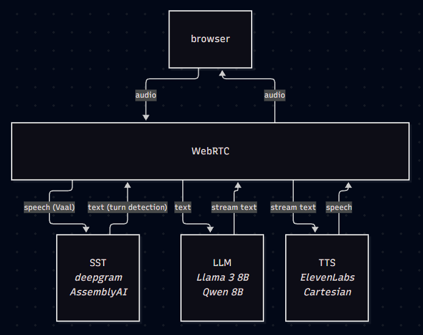

# Background

Mercor is a company whose business consists of two primary parts: an AI interviewer and data labeling. For their former product, there are two primary stakeholders:

- Talent
  - Select form a list of jobs
  - Upload their resume and join interview
  - Complete interview with AI; this is authomatically recorded and graded
- Recruiters/Companies
  - Click into each job listing
  - View candidates' recorded interviews

The implementation, however, is not as trivial as it may seem from the surface. The primary challenges for implementation are as follows:

1. Parsing the users experience, i.e. processing their resume, scraping the links from their resume
2. Post-start interview process. The first four below (a-d) are hard components for building a voice agent, minus the video
   a. Text to Speech, TTS. The step that is least expensive to run out of steps a-c.
   b. WebRTC for real-time web browser communication
   c. Speech to Text, STT. Typically cheaper than TTS.
   d. Small language Model, SLM for reasoning about user responses. A larger model would have more latency which would not be ideal.
   e. For adding video for interviewer, you'd need to add real-time video generation model. Less of these--or at least, quality open-source ones--currently exist compared to TTS and STT models, and otherwise non-self hosted models are typically very expensive (i.e. 5x more than for steps a-d).

The code and architecture analysis primarily references and builds on this tutorial: https://www.youtube.com/watch?v=iNJ7z4YLQFk&t=1066s

# Architecture

We start off by considering the general architecture of voice agents, then move on to the more niche architecture of our AI interviewer app.

## Voice Agent Architectures

There are three primary approaches for building a voice agent.

### Approach 1: Cascaded pipeline

Advantages:

- cheaper
- more flexible

Tradeoffs:

- slower

Architecture diagram:

Consists of three models: SST, LLM, TTS.

Here, Vaal is a service which strips the raw audio of external noise (i.e. dogs barking, toilet flushing in the background).

Other tools that may be used throughout this process:

- LiveKit SDK, a popular library for voice agents which don't necessarily host the LLMs themselves, but let you select/switch fluidly between them. If you don't use this library, you'd just need to build the inference layer yourself.

### Approach 2: Voice model

Advantages:
- faster
- maintainability/dev experience

Tradeoffs:
- more expensive
- dependency lock-in

Architecture diagram:

Consists of a single model which is trained (both inputs and outputs) based on audio, such as OpenAI or Gemini's low-latency voice models.

Oftimes, these voice models will be multimodal as well--that is, be able to accept text, images, perhaps even multiple calls. It is also easier to maintain the code following this approach since we wouldn't need to maintain 3 pipelines.

The tradeoffs here are firstly, that it is around $30-40\%$ more expensive, although clearly not significantly so. Secondly, building based on a specific voice model means it will take at least some engineering effort to switch to a different model later down the line.

## AI Interviewer Architectures

### Approach 1: Direct server connection

Advantages:
- Fast

Tradeoffs:
- System prompt directly via client
- No record of convo, since our server never part of it

Architecture Diagram:

In this approach, we connect the browser directly to our AI server/model, making for a low-latency user experience.

The main tradeoffs are twofold: To begin with, it risks users manipulating the system prompt (since it is passed directly from the client to the server without, say, guardrails that going through a backend could be implemented). It also means we can't have any record of the AI conversations, since our server is never a part of this communication exchange between the client and model.

### Approach 2: Approach 1, but record the convos

Advantages:
- Fast

Tradeoffs
- Clients can still manipulate server prompts

Architecture diagram:

The only difference between this and the prior approach is that we record the conversations with the backend.